# Modernmarket: Architecture Proposal (Phase 0, for approval)

Status: proposal only. No application code has been written and nothing has been committed to the repository. Milestone 1 starts only after your explicit approval.

Figures marked (verify) are estimates or facts that change over time and should be checked before they drive a decision. Legal and tax points are flagged for a Georgian lawyer or accountant; this document does not give legal advice.

---

## 1. Understanding of Modernmarket

Modernmarket is a Georgia-only, multi-vendor marketplace with a premium look. Buyers shop across independent sellers in one cart. The platform does not touch buyer money: buyers pay the seller in cash on delivery (COD) and the parties arrange delivery themselves. Modernmarket earns money three ways, all invoiced or recorded manually in GEL:

1. Commission on eligible completed sales, collected through monthly invoices and manual reconciliation.
2. Seller subscriptions, confirmed manually by an admin.
3. Paid promotions.

Because the platform never holds funds, the core engineering risk is not payments, it is **trust and accounting**: the platform must reliably calculate what each seller owes, prove it with an immutable ledger, and invoice it, even though it cannot verify that cash changed hands. Most of the design below follows from that.

Three account types (buyer, seller, admin with permission levels), two languages (Georgian default, English), one transaction currency (GEL) with display-only USD/EUR.

---

## 2. System architecture

**Modular monolith**, one deployable API, one frontend, one database.

```
Browser
  |  HTTPS (Let's Encrypt)
Nginx (reverse proxy, TLS, gzip, static caching, rate limit at edge)
  |-- /            -> Angular SSR server (public pages) / static bundle (dashboards)
  |-- /api, /ws    -> NestJS API (REST + Socket.IO gateway)
NestJS API
  |-- MySQL 8 (private network only)
  |-- Redis (private network only): rate limiting, BullMQ queues, websocket adapter later
  |-- S3-compatible object storage (DigitalOcean Spaces): public bucket (product images),
  |   private bucket (seller documents, digital files, invoice PDFs, payment evidence)
  |-- SMTP / transactional email provider (via queue)
Background workers (same codebase, separate process/container):
  emails, notification fan-out, monthly invoice job, commission recognition job,
  subscription expiry job, exchange-rate refresh, stale-order auto-cancel, image processing
```

Key principles:

- Module boundaries follow the folders in your spec (`auth`, `orders`, `commissions`, ...). Modules talk through exported services, never through each other's tables. This keeps a later split possible without paying for microservices now.
- All money logic, authorization, pricing, stock and commission calculation run on the backend only.
- Anything slow or failure-prone (email, PDF, image resizing, invoice generation) goes through a queue so it never blocks or breaks an order.
- **Transactional outbox**: domain events (order placed, product approved, ...) are written to an `outbox_events` table inside the same DB transaction as the change, then dispatched by a worker. This guarantees "order saved" and "seller notified" cannot disagree, and it works even if Redis is briefly down.

---

## 3. Technology decisions

| Area | Choice | Why / caveat |
|---|---|---|
| Frontend | Angular (latest stable at project start; spec says 19+), standalone components, Signals, lazy routes, SCSS, CDK, selective Material | Material is used only for complex behaviors (overlays, date pickers, tables); visual identity comes from a custom design system so it does not look like default Material. |
| SSR | Angular SSR (hydration) for public pages only: home, category, search, product, storefront | Required for SEO and share previews. Dashboards (buyer/seller/admin) are client-rendered. Costs about 150-300 MB extra RAM for the SSR Node process. |
| Backend | NestJS, strict TypeScript, REST, Swagger/OpenAPI, class-validator DTOs | Standard, testable, matches the spec. |
| ORM / DB | Prisma + MySQL 8 | See caveats in section 20 (raw SQL needed for FULLTEXT, triggers, row locks). |
| Auth | Argon2id, 15-minute JWT access token, rotating refresh token | Details in section 10. |
| Queue | BullMQ on Redis (container on the same droplet, no extra cost) | Justified now because email retry, invoice jobs and websockets all need it. |
| Storage | DigitalOcean Spaces (S3-compatible), `sharp` for image variants | About 5 USD/month base (verify). Keep an S3 abstraction so the provider can change. |
| Realtime | Socket.IO gateway in NestJS | Single instance first; Redis adapter when scaling horizontally. |
| PDF | Server-side PDF from HTML template (e.g. Puppeteer or a lighter library) | Puppeteer needs about 300 MB+ RAM while rendering; prefer a lightweight library (e.g. pdfmake) for invoices. Georgian glyph support must be tested with an embedded font. |
| Infra | Docker Compose, Nginx, GitHub Actions, Let's Encrypt (certbot) | Same stack for staging and production, different env files. |
| Error monitoring | Self-hosted-free option first (Sentry free tier or GlitchTip) | Do not add paid services without your sign-off (rule 25). |

Money rule: all amounts are `DECIMAL(12,2)` in GEL, handled in code with `Prisma.Decimal` / `decimal.js`. No `number` arithmetic on money anywhere.

IDs: internal `BIGINT AUTO_INCREMENT` primary keys (fast joins, small indexes) plus a public `uuid` column (UUIDv4 or v7) used in all URLs and APIs. Internal IDs never leave the backend.

Timestamps: stored in UTC. Billing periods and "end of month" are computed in `Asia/Tbilisi` (UTC+4, no DST) so a sale at 23:30 on the 31st lands in the right invoice.

---

## 4. Database schema (proposed MySQL design)

Conventions for every table unless stated: `id`, `uuid`, `created_at`, `updated_at`; `deleted_at` only where soft delete is listed. FK columns are `<entity>_id`. Statuses are MySQL ENUMs managed by Prisma enums. "UQ" = unique constraint. All financial tables are append-only (see section 14).

### 4.1 Identity and users

| Table | Key columns / constraints |
|---|---|
| `users` | email (UQ), password_hash, status (active/blocked/pending_verification), email_verified_at, locale (ka/en), display_currency, last_login_at, deleted_at |
| `roles` | key (UQ: buyer, seller, admin, super_admin, ...) |
| `permissions` | key (UQ, e.g. `products.moderate`, `invoices.issue`, `users.block`) |
| `role_permissions` | role_id, permission_id (UQ pair) |
| `user_roles` | user_id, role_id (UQ pair) |
| `refresh_tokens` | user_id, family_id, token_hash (UQ), expires_at, revoked_at, replaced_by_id, ip, user_agent |
| `password_reset_tokens`, `email_verification_tokens` | user_id, token_hash (UQ), expires_at, used_at |
| `buyer_profiles` | user_id (UQ), first_name, last_name, phone, preferences JSON |
| `seller_profiles` | user_id (UQ), seller_type (individual/business), legal_name, personal_or_company_id, phone, contact_address, status (pending/under_review/approved/rejected/suspended), approved_at, approved_by, suspended_reason |
| `addresses` | user_id, label, recipient, phone, city, district, street, building, notes, lat/lng nullable, is_default |
| `seller_applications` | seller_profile_id, status, submitted_at, reviewed_by, reviewed_at, rejection_reason, revision_no |
| `seller_documents` | application_id, doc_type, storage_key (private bucket), mime, size, checksum |

Personal ID / company ID is sensitive. Store encrypted at rest (application-level encryption) and never log it.

### 4.2 Marketplace

| Table | Key columns / constraints |
|---|---|
| `seller_stores` | seller_profile_id (UQ), slug (UQ), name, description_ka/en, logo_key, cover_key, policies_ka/en, location, status (open/closed/suspended) |
| `categories` | parent_id, slug (UQ), path (materialized path for fast subtree), sort_order, is_active, image_key, product_kind (physical/digital/vehicle), commission_rate nullable |
| `category_translations` | category_id, locale (UQ pair), name, description, seo_title, seo_description |
| `brands` | slug (UQ), name, logo_key, is_active |
| `products` | seller_id, store_id, category_id, brand_id nullable, kind (physical/digital/vehicle), slug (UQ), sku, condition (new/used/refurbished), price_gel, compare_at_price_gel, discount_percent (derived or stored), status (draft/pending/approved/rejected/archived/suspended), published_at, location, rating_avg, rating_count, view_count, sales_count, moderation_revision, deleted_at |
| `product_translations` | product_id, locale (UQ pair), title, description, seo_title, seo_description. FULLTEXT index on (title, description). |
| `product_images` | product_id, variant_id nullable, storage_key, alt, sort_order |
| `product_variants` | product_id, sku (UQ per seller), price_gel, options JSON (size/color/...), is_active |
| `attribute_definitions` | category_id, key, type (text/number/enum/boolean), is_filterable, is_comparable, translations |
| `product_attribute_values` | product_id, attribute_id, value_text/value_number/option_id |
| `product_moderation_history` | product_id, revision_no, action (submitted/approved/rejected/auto_resubmitted/suspended), actor_id, reason, snapshot JSON (what was reviewed) |
| `vehicle_details` | product_id (UQ), manufacturer, model, year, mileage_km, engine, fuel_type, transmission, drive_type, condition, listing_status (available/reserved/sold/archived) |

"Important edit" (triggers re-review) is defined as a change to: title, description, category, images, price change above a threshold (configurable, proposed 30%), kind-specific attributes, or digital file. Stock and minor price edits do not trigger re-review.

### 4.3 Inventory

| Table | Key columns / constraints |
|---|---|
| `inventory` | product_id or variant_id (exactly one set, UQ), quantity_on_hand, quantity_reserved, low_stock_threshold. CHECK (quantity_on_hand >= 0). |
| `inventory_movements` | inventory_id, type (initial/adjust/reserve/release/commit/restock), delta, reference_type, reference_id, actor_id, created_at. Append-only. |
| `stock_reservations` | seller_order_item_id (UQ), inventory_id, quantity, status (held/committed/released), expires_at |

### 4.4 Shopping

`carts` (user_id UQ), `cart_items` (cart_id, product_id, variant_id, quantity; UQ on cart+variant), `wishlists` (user_id, share_token nullable), `wishlist_items`, `comparisons`, `comparison_items` (max items per category enforced in service), `recently_viewed` (user_id or anonymous_id, product_id, viewed_at; pruned to latest N).

Cart stores references and quantity only. Prices are recomputed from the product at read time and again at checkout.

### 4.5 Orders

| Table | Key columns / constraints |
|---|---|
| `orders` (parent / checkout) | buyer_id, order_number (UQ, human-readable), idempotency_key, contact_name/phone/email, shipping address snapshot JSON, total_gel, status (derived), placed_at |
| `seller_orders` | order_id, seller_id, seller_order_number (UQ), status (see section 12), subtotal_gel, discount_gel, total_gel, commission_status (not_eligible/eligible/recognized/reversed), accepted_at, dispatched_at, delivered_at, completed_at, cancelled_at, auto_cancel_at |
| `order_items` | seller_order_id, product_id, variant_id, title snapshot, sku snapshot, unit_price_gel, quantity, line_total_gel, kind, applied_commission_rate, status (active/cancelled/refunded) |
| `order_status_history` | seller_order_id, from_status, to_status, actor_id, actor_role, reason, created_at. Append-only. |
| `delivery_arrangements` | seller_order_id, method (seller_delivery/buyer_pickup/courier_arranged), notes, agreed_at, tracking_reference nullable |
| `payment_records` | seller_order_id, method (cod), status, amount_expected_gel, amount_collected_gel, collected_at, recorded_by, buyer_confirmed_at, note |
| `payment_status_history` | payment_record_id, from/to, actor, reason. Append-only. |
| `refunds` | seller_order_id, order_item_id nullable, amount_gel, reason, status (requested/approved/rejected/recorded), decided_by |
| `disputes` | seller_order_id, opened_by, type (non_delivery/not_as_described/payment_disagreement/other), status (open/investigating/resolved_buyer/resolved_seller/closed), resolution_note, resolved_by |
| `dispute_messages` | dispute_id, author_id, body, attachments |
| `idempotency_keys` | user_id, key, request_hash, response_snapshot, UQ(user_id, key) |

Order totals and line prices are snapshots. They are never recomputed after placement, so price or exchange-rate changes cannot alter history.

### 4.6 Finance

| Table | Key columns / constraints |
|---|---|
| `commission_rules` | scope (global/category/seller/promotional), category_id nullable, seller_id nullable, rate_percent DECIMAL(5,2), valid_from, valid_to, priority, created_by |
| `seller_commission_ledger` | seller_id, seller_order_id, order_item_id nullable, entry_type (accrual/reversal/adjustment), gross_eligible_amount_gel, commission_rate, commission_amount_gel (signed), status (recognized/invoiced/void_by_reversal), reason, created_by, period_month (Tbilisi). **UQ(order_item_id, entry_type, correction_seq)** for idempotency. Append-only. |
| `seller_balances` | seller_id (UQ), accrued_uninvoiced_gel, invoiced_outstanding_gel, overdue_gel, updated_at. A cache rebuilt from the ledger and invoices; never the source of truth. |
| `seller_invoices` | seller_id, invoice_number (UQ, sequential per year e.g. MM-2026-000123), period_start, period_end, **UQ(seller_id, period_start, period_end, invoice_type)**, status (draft/issued/partially_paid/paid/overdue/cancelled), issue_date, due_date, subtotal_gel, adjustments_gel, vat_gel nullable, total_gel, paid_gel, pdf_key, issued_by, issued_at |
| `seller_invoice_items` | invoice_id, ledger_entry_id (**UQ**: a ledger entry can appear on exactly one invoice), description, amounts |
| `seller_invoice_payments` | invoice_id, amount_gel, paid_at, reference, evidence_key, recorded_by. Append-only; reversals are negative rows. |
| `credit_notes` | invoice_id, amount_gel, reason, issued_by (corrections to issued invoices) |
| `subscription_plans` | key, name_ka/en, monthly_price_gel, max_active_products, promotion_allowance, commission_rate_override, features JSON, is_active |
| `seller_subscriptions` | seller_id, plan_id, status (pending_payment/active/expired/cancelled), starts_at, expires_at |
| `subscription_payments` | subscription_id, amount_gel, paid_at, reference, recorded_by |
| `promotion_types` | key, placement (featured/homepage/category/search), price_gel_per_day, max_slots, is_active |
| `promotions` | seller_id, product_id, type_id, status (requested/approved/rejected/active/expired/cancelled), starts_at, ends_at, price_gel, payment_status |
| `promotional_listings` | promotion_id, placement_key, slot_index; UQ(placement_key, slot_index, time range) enforced in service plus a check query |
| `platform_revenue_entries` | source (commission/subscription/promotion), amount_gel, reference_type/id, recognized_at. Append-only; gives analytics a clean, separate revenue table. |

### 4.7 Communication

`conversations` (type: product/order/vehicle_inquiry/support, product_id nullable, seller_order_id nullable), `conversation_participants` (conversation_id, user_id, last_read_message_id), `messages` (conversation_id, sender_id, body, attachments JSON, created_at), `message_reports`, `notifications` (user_id, type, payload JSON, read_at), `notification_preferences` (user_id, type, in_app, email), `email_outbox` (to, template, payload, status, attempts, last_error, next_attempt_at), `vehicle_inquiries` (product_id, buyer_id, seller_id, message, contact preference, status, conversation_id).

### 4.8 Special categories

`digital_product_files` (product_id, storage_key in private bucket, filename, size, checksum, version), `digital_download_permissions` (seller_order_item_id, buyer_id, file_id, status active/revoked/expired, max_downloads, download_count, expires_at, granted_at), `digital_download_log`.

### 4.9 Platform

`exchange_rates` (currency UQ, rate_per_gel, source, updated_at), `exchange_rate_history` (append-only), `platform_settings` (key UQ, value JSON, updated_by), `home_sections` (key, type, config JSON, sort_order, is_enabled, for admin-configurable homepage), `audit_logs` (actor_id, actor_role, action, entity_type, entity_id, before JSON, after JSON, ip, user_agent, created_at; append-only), `search_history`, `search_terms_popular` (aggregated), `newsletter_subscriptions` (email UQ, confirmed_at, unsubscribed_at), `reviews` (see below), `outbox_events`, `legal_documents` (terms/privacy versions) and `user_consents` (who accepted which version, when).

`reviews`: product_id, seller_order_item_id (UQ, one review per eligible purchase), buyer_id, rating (1-5, CHECK), body, status (pending/published/hidden), is_verified_purchase, `review_images`, `review_reports`, `seller_review_responses`.

### 4.10 Indexing highlights

- `products`: (status, category_id, published_at), (seller_id, status), (status, price_gel), (status, rating_avg), FULLTEXT on `product_translations`.
- `seller_orders`: (seller_id, status, created_at), (order_id).
- `seller_commission_ledger`: (seller_id, period_month), UQ idempotency key.
- `audit_logs`: (entity_type, entity_id, created_at), (actor_id, created_at).
- `notifications`: (user_id, read_at, created_at). `messages`: (conversation_id, id).

---

## 5. ER diagram (core relationships)

```mermaid
erDiagram
  USERS ||--o| BUYER_PROFILES : has
  USERS ||--o| SELLER_PROFILES : has
  USERS ||--o{ USER_ROLES : has
  ROLES ||--o{ USER_ROLES : grants
  ROLES ||--o{ ROLE_PERMISSIONS : has
  PERMISSIONS ||--o{ ROLE_PERMISSIONS : in
  USERS ||--o{ ADDRESSES : owns
  USERS ||--o{ REFRESH_TOKENS : holds
  SELLER_PROFILES ||--o{ SELLER_APPLICATIONS : submits
  SELLER_APPLICATIONS ||--o{ SELLER_DOCUMENTS : attaches
  SELLER_PROFILES ||--|| SELLER_STORES : runs
  SELLER_PROFILES ||--o{ PRODUCTS : lists
  CATEGORIES ||--o{ CATEGORIES : parent_of
  CATEGORIES ||--o{ PRODUCTS : contains
  BRANDS ||--o{ PRODUCTS : brands
  PRODUCTS ||--o{ PRODUCT_TRANSLATIONS : has
  PRODUCTS ||--o{ PRODUCT_IMAGES : has
  PRODUCTS ||--o{ PRODUCT_VARIANTS : has
  PRODUCTS ||--o{ PRODUCT_ATTRIBUTE_VALUES : has
  PRODUCTS ||--o{ PRODUCT_MODERATION_HISTORY : audited_by
  PRODUCTS ||--o| VEHICLE_DETAILS : may_have
  PRODUCTS ||--o{ DIGITAL_PRODUCT_FILES : may_have
  PRODUCTS ||--o{ INVENTORY : stocked_as
  INVENTORY ||--o{ INVENTORY_MOVEMENTS : logs
  USERS ||--o| CARTS : has
  CARTS ||--o{ CART_ITEMS : contains
  USERS ||--o{ ORDERS : places
  ORDERS ||--o{ SELLER_ORDERS : splits_into
  SELLER_PROFILES ||--o{ SELLER_ORDERS : fulfils
  SELLER_ORDERS ||--o{ ORDER_ITEMS : contains
  SELLER_ORDERS ||--o{ ORDER_STATUS_HISTORY : logs
  SELLER_ORDERS ||--o| DELIVERY_ARRANGEMENTS : has
  SELLER_ORDERS ||--o| PAYMENT_RECORDS : has
  SELLER_ORDERS ||--o{ REFUNDS : may_have
  SELLER_ORDERS ||--o{ DISPUTES : may_have
  ORDER_ITEMS ||--o{ SELLER_COMMISSION_LEDGER : accrues
  SELLER_PROFILES ||--o{ SELLER_COMMISSION_LEDGER : owes
  SELLER_PROFILES ||--o{ SELLER_INVOICES : billed
  SELLER_INVOICES ||--o{ SELLER_INVOICE_ITEMS : lists
  SELLER_COMMISSION_LEDGER ||--o| SELLER_INVOICE_ITEMS : invoiced_once
  SELLER_INVOICES ||--o{ SELLER_INVOICE_PAYMENTS : paid_by
  SELLER_INVOICES ||--o{ CREDIT_NOTES : corrected_by
  SUBSCRIPTION_PLANS ||--o{ SELLER_SUBSCRIPTIONS : of
  SELLER_PROFILES ||--o{ SELLER_SUBSCRIPTIONS : holds
  SELLER_SUBSCRIPTIONS ||--o{ SUBSCRIPTION_PAYMENTS : paid_by
  PROMOTION_TYPES ||--o{ PROMOTIONS : of
  PRODUCTS ||--o{ PROMOTIONS : promoted
  ORDER_ITEMS ||--o| REVIEWS : reviewed_once
  CONVERSATIONS ||--o{ CONVERSATION_PARTICIPANTS : has
  CONVERSATIONS ||--o{ MESSAGES : contains
  PRODUCTS ||--o{ VEHICLE_INQUIRIES : receives
  ORDER_ITEMS ||--o{ DIGITAL_DOWNLOAD_PERMISSIONS : grants
```



---

## 6. Main relationships and constraints worth stating

- A product belongs to exactly one seller and one store. Every write checks `product.seller_id == caller's seller_id` in the service layer (resource ownership), not only the route guard.
- One checkout creates one `orders` row and one `seller_orders` row per distinct seller. `order_items` hang off the seller order, never directly off the parent.
- A ledger entry is invoiced at most once (UQ on `seller_invoice_items.ledger_entry_id`), and an order item gets at most one accrual (UQ on the ledger idempotency key). This makes commission calculation and invoice generation safe to re-run.
- A review is tied to one `order_item` (UQ), which is how duplicate and non-purchase reviews are prevented.
- `inventory.quantity_on_hand >= 0` is enforced both by a CHECK constraint and by the atomic update pattern (section 11).

---

## 7. Frontend route structure

Public (SSR, lazy):

```
/                              home
/c/:categorySlug(/**)          category browse with filters
/search                        results, ?q=&filters
/p/:productSlug                product details
/s/:storeSlug                  seller storefront
/v/:vehicleSlug                vehicle listing (inquiry form, no cart)
/compare                       comparison
/wishlist                      wishlist (shared: /wishlist/shared/:token)
/cart   /checkout   /checkout/confirmation/:orderNumber
/auth/login  /auth/register  /auth/forgot-password  /auth/reset-password  /auth/verify-email
/sell                          seller landing + application
/pages/:slug                   terms, privacy, help (admin-managed)
```

Buyer area (`/account`, auth guard): `profile`, `addresses`, `orders`, `orders/:orderNumber`, `messages`, `notifications`, `reviews`, `downloads`, `preferences`.

Seller area (`/seller`, seller guard + approved-status guard): `overview`, `products`, `products/new`, `products/:id/edit`, `inventory`, `orders`, `orders/:id`, `storefront`, `finance` (`ledger`, `statements`, `invoices`, `payments`), `subscription`, `promotions`, `vehicles/inquiries`, `messages`, `reviews`, `support`.

Admin area (`/admin`, admin guard + per-route permission guard): `dashboard`, `sellers` (+ `applications`), `users`, `products/moderation`, `categories`, `brands`, `orders`, `disputes`, `refunds`, `finance` (`commissions`, `invoices`, `reconciliation`, `reports`), `subscriptions`, `promotions`, `reviews`, `analytics`, `settings` (home sections, languages, currencies, commission rules, plans), `audit-logs`, `admins`.

Guards are UX only; the backend re-checks everything.

---

## 8. Backend module structure

As in your spec (`auth`, `users`, `buyers`, `sellers`, `seller-applications`, `products`, `categories`, `brands`, `inventory`, `cart`, `orders`, `payments`, `commissions`, `invoices`, `subscriptions`, `promotions`, `reviews`, `wishlist`, `comparison`, `messaging`, `notifications`, `search`, `analytics`, `vehicles`, `uploads`, `admin`, `settings`, `audit`), plus:

- `common/` guards, decorators (`@Roles`, `@Permissions`, `@CurrentUser`), interceptors, filters, pagination, money utilities, idempotency interceptor.
- `outbox/` dispatcher and event handlers.
- `jobs/` BullMQ processors (email, invoices, commissions, subscriptions, exchange rates, auto-cancel).
- `currency/` rates and display conversion.
- `files/` storage abstraction, signed URLs, MIME/magic-byte validation.
- `legal/` consents and document versions.

Rules: controllers are thin; services own business rules; Prisma access lives in services/repositories of the owning module; cross-module calls go through exported services.

---

## 9. Main API endpoints

Prefix `/api/v1`. Auth: `P` public, `B` buyer, `S` approved seller, `A` admin (with permission).

**Auth** (P): `POST /auth/register`, `/auth/login`, `/auth/refresh`, `/auth/logout`, `/auth/forgot-password`, `/auth/reset-password`, `/auth/verify-email`, `/auth/resend-verification`. `GET /auth/me`.

**Catalog** (P): `GET /categories` (tree), `/categories/:slug`, `/brands`, `/products` (filters, sort, pagination), `/products/:slug`, `/products/:slug/related`, `/products/:slug/reviews`, `/stores/:slug`, `/stores/:slug/products`, `/search/suggest`, `/search/popular`, `GET /currency/rates`, `GET /home` (configured sections).

**Buyer** (B): `GET/PATCH /me/profile`, `CRUD /me/addresses`, `GET/POST/PATCH/DELETE /cart(/items)`, `POST /checkout` (requires `Idempotency-Key`), `GET /orders`, `/orders/:orderNumber`, `POST /orders/:id/cancel`, `/seller-orders/:id/confirm-receipt`, `/seller-orders/:id/dispute`, `CRUD /wishlist`, `/comparison`, `POST /reviews`, `GET /me/downloads`, `GET /downloads/:permissionId` (authorized stream or short-lived signed URL), `GET /search/history`.

**Seller application and store** (authenticated user): `POST /seller-applications`, `GET /seller-applications/me`, `POST /seller-applications/:id/documents`. (S): `GET/PATCH /seller/store`.

**Seller products** (S): `CRUD /seller/products`, `POST /seller/products/:id/submit`, `/archive`, `PATCH /seller/products/:id/inventory`, `POST /uploads/product-image` (signed upload), `POST /seller/products/:id/digital-files`.

**Seller orders and finance** (S): `GET /seller/orders`, `/seller/orders/:id`, `POST /seller/orders/:id/accept|reject|process|ready|dispatch|deliver`, `POST /seller/orders/:id/payment/collected`, `PATCH /seller/orders/:id/delivery`, `GET /seller/dashboard`, `/seller/finance/ledger`, `/seller/finance/statements`, `/seller/invoices`, `/seller/invoices/:id/pdf`, `/seller/subscription`, `POST /seller/promotions`, `GET /seller/vehicle-inquiries`, `PATCH /seller/vehicles/:id/status`, `POST /reviews/:id/response`.

**Messaging and notifications** (authenticated): `GET/POST /conversations`, `GET /conversations/:id/messages`, `POST /conversations/:id/messages`, `POST /messages/:id/report`, `GET /notifications`, `PATCH /notifications/:id/read`, `GET/PUT /notifications/preferences`, WebSocket `/ws` (events: `message.new`, `notification.new`, `order.updated`). `POST /vehicles/:id/inquiries` (B).

**Admin** (A + permission): `GET /admin/seller-applications`, `POST /admin/seller-applications/:id/approve|reject|review`, `POST /admin/sellers/:id/suspend|reinstate`, `GET /admin/products/pending`, `POST /admin/products/:id/approve|reject|suspend`, `CRUD /admin/categories|brands|attributes`, `GET /admin/orders`, `POST /admin/orders/:id/override` (reason required), `GET/POST /admin/disputes/:id/...`, `POST /admin/refunds/:id/approve|reject`, `CRUD /admin/commission-rules`, `POST /admin/invoices/generate`, `GET /admin/invoices/:id/preview`, `POST /admin/invoices/:id/issue|cancel`, `POST /admin/invoices/:id/payments`, `POST /admin/invoices/:id/credit-notes`, `GET /admin/reports/*` (CSV/XLSX export), `CRUD /admin/subscription-plans`, `POST /admin/subscriptions/:id/confirm-payment`, `CRUD /admin/promotion-types`, `POST /admin/promotions/:id/approve|reject`, `GET/POST /admin/reviews/...` (moderation), `GET /admin/analytics/*`, `PUT /admin/settings/*`, `PUT /admin/home-sections`, `PUT /admin/exchange-rates`, `GET /admin/audit-logs`, `CRUD /admin/admins`.

Standards: URL versioning, cursor or page pagination with max page size, consistent error envelope `{ code, message, details, requestId }`, OpenAPI generated from DTOs.

---

## 10. Authentication and authorization architecture

- Passwords: Argon2id with tuned parameters; minimum length and breached-password check (k-anonymity range API or a local list).
- Access token: JWT, 15 minutes, kept **in memory** on the frontend, sent as `Authorization: Bearer`. Never in localStorage.
- Refresh token: opaque random value, stored **hashed** in `refresh_tokens`, delivered as `HttpOnly; Secure; SameSite=Strict` cookie scoped to `/api/v1/auth`. Rotated on every use. Each token belongs to a `family_id`; reuse of an already-rotated token revokes the whole family (theft detection). Logout revokes the family.
- CSRF: because only the refresh and logout endpoints use the cookie, protect them with `SameSite=Strict` plus a custom header requirement and Origin checking. Serving the app and API under the same registrable domain keeps `SameSite=Strict` workable.
- Brute force: per-IP and per-account rate limits on login, reset and verification endpoints (Redis), progressive delays, optional lockout notification.
- Authorization layers: (1) role guard, (2) permission guard for admins (RBAC via `permissions`), (3) **resource ownership checks inside services** (seller owns product/order, buyer owns order/conversation, participant owns message), (4) status guards (seller must be `approved` and not `suspended` to write products or accept orders).
- Admin levels: `super_admin` manages admins and settings; other admin roles are permission sets (moderator, finance, support). Admin sessions get shorter refresh lifetimes; 2FA (TOTP) for admin accounts is strongly recommended (free to implement; flagged as a decision).
- Every privileged action writes an `audit_logs` row in the same transaction.

---

## 11. Multi-vendor checkout architecture

1. **Cart** is references plus quantities. It may hold physical and digital items from many sellers. Vehicles cannot be added (rejected by the API, not just hidden in the UI).
2. **`POST /checkout`** carries `Idempotency-Key`. The server looks up `(user_id, key)`: if found with the same request hash, it returns the stored response; same key with a different body returns 422.
3. Inside **one database transaction**:
   - Load cart items with current product, variant, seller and status; fail if any product is not `approved`, seller not `approved`, or price/quantity invalid. Prices come from the DB, never the client.
   - Group by seller. Create `orders` and one `seller_orders` per seller, plus `order_items` with price and title snapshots and the applicable commission rate snapshot.
   - **Decrement stock atomically per variant**: `UPDATE inventory SET quantity_on_hand = quantity_on_hand - :q WHERE id = :id AND quantity_on_hand >= :q`. If zero rows are affected, the checkout fails with a clear "insufficient stock" error and everything rolls back. Items are processed in a fixed order (by inventory id) to avoid deadlocks. Each decrement writes an `inventory_movements` row (`reserve`) and a `stock_reservations` row.
   - Create `payment_records` (COD, awaiting collection), `delivery_arrangements`, status history rows, the idempotency record, outbox events (notify sellers and buyer), and clear the cart.
4. Commit. The worker then sends notifications and emails. Email failure never affects the order.
5. **Partial cancellation**: each seller order is independent. Cancelling or rejection of Seller 1's order restocks only its items and does not touch Seller 2's. The parent order status is derived: all children completed -> completed; all cancelled/rejected -> cancelled; mixed -> `partially_fulfilled` (display state). Buyers can cancel a seller order before it is dispatched; after dispatch, only via dispute/refund. Item-level cancellation inside one seller order is allowed only before acceptance (proposed) and requires recalculating the seller-order total.
6. **Unresponsive sellers**: a seller order still `pending` after a configurable window (proposed 48 hours) auto-cancels and restocks; the buyer is notified.

Tested against: concurrent purchases of the last unit, duplicate submissions, partial stock failure, rollback integrity.

---

## 12. Order lifecycle (per seller order)

```
PENDING --accept--> ACCEPTED --process--> PROCESSING --ready--> READY_FOR_DISPATCH --dispatch--> DISPATCHED --deliver--> DELIVERED --(rules below)--> COMPLETED
PENDING --reject--> REJECTED (restock)
PENDING/ACCEPTED/PROCESSING/READY --cancel (buyer or seller, with reason)--> CANCELLED (restock)
DISPATCHED/DELIVERED --dispute--> DISPUTED --admin resolution--> COMPLETED | CANCELLED (refund path)
```

- Transitions are enforced by a state-machine table in code; every transition writes `order_status_history` and an audit-quality actor.
- `DELIVERED` is set by the seller (or by the buyer confirming receipt). **`COMPLETED` is never set just because of dispatch.** Proposed rule: COMPLETED when delivered **and** (COD recorded as collected **or** buyer confirmed receipt), or automatically N days (proposed 7) after DELIVERED with no open dispute.
- Admin overrides require a reason and are audited.
- Failed delivery: seller marks `DELIVERY_FAILED` as a reason on cancellation (not a separate state), stock is restocked (seller may choose to write it off), commission is not recognized.

---

## 13. COD payment lifecycle (separate from order status)

```
AWAITING_COLLECTION --seller records--> COLLECTED_BY_SELLER
AWAITING_COLLECTION --seller records--> NOT_COLLECTED (delivery failed / buyer refused)
any --buyer or seller raises--> PAYMENT_DISPUTED --admin--> COLLECTED_BY_SELLER | NOT_COLLECTED
COLLECTED_BY_SELLER --refund recorded--> PARTIALLY_REFUNDED | REFUNDED
```

- Seller records collection and amount. Buyer can confirm receipt/payment. If the two disagree, a dispute is opened automatically.
- Modernmarket never holds or moves this money. Refunds are *recorded* by the platform but physically done by seller and buyer.
- The collected amount does not become platform revenue. Only the commission on it does.
- Because the platform cannot verify cash, protections are procedural: dual confirmation, dispute handling, full history, and seller trust signals. This limitation should be stated plainly in the seller terms.

---

## 14. Commission calculation architecture

**Rate resolution** (highest priority wins, resolved at order placement and snapshotted on each order item): active promotional rule for the seller > seller-specific rule > category rule (nearest ancestor with a rule) > subscription-plan override > global rule. Rate is `DECIMAL(5,2)` percent.

**Recognition point (proposed, needs your decision):** commission accrues when the seller order reaches `COMPLETED`. This means no commission on cancelled, rejected, disputed-unresolved or merely dispatched orders.

**Calculation**: for each completed order item, `commission = round_half_up(line_total_gel * rate / 100, 2)`. Rounding is per item (proposed) so ledger lines sum exactly to the invoice. Eligible amount excludes vehicles entirely and excludes cancelled items.

**Ledger mechanics**:
- A recognition job (also triggered by the completion event) inserts `accrual` rows. The unique idempotency key means running it twice cannot double-charge.
- Refunds, cancellations after completion, and dispute outcomes insert `reversal` rows (negative) linked to the original. Manual corrections insert `adjustment` rows with a mandatory reason and an actor.
- Rows are **never updated or deleted**. Enforce with: no UPDATE/DELETE in the application layer, plus MySQL triggers (`BEFORE UPDATE/DELETE` signal an error), added through a raw-SQL Prisma migration. Only the `status` bookkeeping that links an entry to an invoice is stored on the invoice item side, not by mutating the ledger.
- `seller_balances` is a cache recomputable from ledger + invoices. A nightly reconciliation job compares the cache with a fresh recomputation and alerts on mismatch.

Revenue entries (`platform_revenue_entries`) are written when an invoice item is issued (commission), a subscription payment is confirmed, or a promotion payment is confirmed, so analytics separates the three streams without guessing.

---

## 15. Monthly seller invoice architecture

1. **Job** runs on the 1st of each month at 00:30 Tbilisi time (idempotent, can be re-run by admin for a specific month).
2. For each seller with un-invoiced ledger entries in the previous month (Tbilisi boundaries), create a `draft` invoice with `UQ(seller_id, period_start, period_end, invoice_type)`. If it exists, the job does nothing (or only refreshes it while still `draft`).
3. Draft lines reference ledger entries (each entry linked once). Totals: gross eligible sales, rate breakdown, commission, adjustments.
4. Admin previews, then **issues** (draft -> issued): assigns a gapless sequential number from a counter row locked in the transaction, sets issue and due dates (due offset configurable, proposed 14 days), freezes the lines, generates the PDF, notifies the seller.
5. **Issued invoices are immutable.** Later corrections (refunds in a following month, errors) become `reversal`/`adjustment` ledger entries that appear on the next invoice, or a `credit_note` against the issued invoice.
6. Payments are recorded manually (amount, date, reference, optional evidence file). Status moves issued -> partially_paid -> paid; a daily job flags `overdue` after the due date and notifies the seller.
7. Statements: seller sees per-month statement, ledger, invoices, payment history and outstanding balance; admin gets outstanding, paid, overdue and reconciliation reports exportable to CSV and XLSX.
8. Overdue policy (proposed, decision needed): reminders at due date and +7 days; optional automatic restriction (cannot publish new products) after a configurable threshold; suspension remains an admin decision.

---

## 16. Product moderation lifecycle

```
DRAFT --submit--> PENDING --approve--> APPROVED (public)
PENDING --reject(reason required)--> REJECTED --seller edits--> DRAFT --submit--> PENDING
APPROVED --important edit--> PENDING (stays visible with the last approved snapshot, or hidden: decision needed)
APPROVED --admin suspend / seller archive--> SUSPENDED / ARCHIVED
```

- Only `APPROVED` products from `approved`, non-suspended sellers appear in public queries. This filter lives in one shared query builder used by catalog, search, storefront, sitemap and recommendations so no endpoint can forget it.
- `moderation_revision` increments on each submit. `product_moderation_history` stores action, actor, reason and a JSON snapshot of what was reviewed.
- For important edits, the cleanest approach is to keep the **approved version live** until the new version is approved (requires storing a pending revision), at the cost of extra complexity. The simpler approach hides the product while re-review is pending. Decision needed.
- Suspending a seller hides all their products and blocks new orders; existing open orders are kept visible to buyer and seller until resolved.

---

## 17. Vehicle inquiry architecture

- Vehicles are `products.kind = 'vehicle'` with a one-to-one `vehicle_details` row, sharing moderation, images, translations and store with other products.
- No cart, no checkout, no inventory, no commission. The cart API rejects vehicles server-side.
- A buyer submits `vehicle_inquiries` (message plus preferred contact). That creates (or reuses) a `conversation` of type `vehicle_inquiry` between buyer and seller; the seller is notified.
- Seller sets `listing_status` (available/reserved/sold/archived). Sold or archived listings leave search but keep their URL with a "sold" state for SEO continuity.
- Revenue from vehicles is via configurable **listing fees and promotions**, invoiced through the same manual flow (a `listing_fee` invoice line type). Fee amounts are a decision.
- Spam control: rate limit inquiries per buyer, require verified email.

---

## 18. Currency conversion architecture

- Every stored amount is GEL. USD/EUR exist only in the presentation layer.
- `exchange_rates` holds the current rate per display currency; every change appends to `exchange_rate_history`. Admin can set rates manually; an optional job can fetch the National Bank of Georgia's official rates (verify availability and terms) and either apply them automatically or queue them for admin approval.
- The frontend fetches rates, caches them, and converts with `Decimal`-safe rounding for display, always labelled "approx." The checkout page, order confirmation, invoices and emails state the GEL amount as the binding amount.
- Orders snapshot nothing about display currencies, which keeps historical amounts independent of future rate changes. If you later want to show "approx. USD at time of order", a snapshot column can be added.
- API rejects any currency parameter other than GEL on cart/checkout endpoints.

---

## 19. Security considerations

- **Seller isolation** is the largest threat surface (insecure direct object references). Mitigations: ownership checks in services, query scoping by `seller_id` from the token (never from the request), automated tests that attempt cross-seller access on every seller endpoint, and non-guessable public UUIDs.
- **Digital files**: private bucket, no public URLs, access only through an authenticated endpoint that checks `digital_download_permissions` (status, expiry, download count), then streams or issues a signed URL valid for a minute or two. Filenames randomized in storage. Optional malware scanning (ClamAV needs about 1 GB RAM; consider scanning on a worker or delaying until needed).
- **Uploads**: size limits, extension plus MIME plus magic-byte validation, image re-encoding (strips metadata and polyglot payloads), random keys, EXIF GPS stripping.
- **Money tampering**: client sends only product IDs and quantities. Totals, rates and commission are server-calculated.
- **Injection/XSS**: Prisma parameterization, strict DTO validation (whitelist, forbid unknown), output encoding (Angular default), sanitized rich text for descriptions (allow-list or plain text with limited markdown), CSP header.
- **Headers/CORS**: Helmet, strict CORS allow-list, HSTS, no wildcard origins with credentials.
- **Secrets**: only in environment/secret store, never in the repo; `.env.example` only. Separate secrets per environment.
- **Privacy**: personal IDs encrypted at rest; PII excluded from logs; data export/deletion process required under Georgian personal data protection law (verify current requirements with counsel).
- **Abuse**: rate limits on messaging, reviews, inquiries and search; report flows; admin audit of every moderation and financial action.
- **Backups**: encrypted, off-droplet, restore tested.

---

## 20. Performance considerations and technical risks

- **Search**: MySQL FULLTEXT with boolean-mode prefix queries (`term*`) is a reasonable start. Georgian is agglutinative, so stemming is absent and recall depends on prefix matching; MySQL's default tokenizer splits on word boundaries and should handle Georgian script, but this **must be validated early with real Georgian data** (also tune `innodb_ft_min_token_size`, stopwords, collation). Typo tolerance is weak in MySQL; the search module is behind an interface so Meilisearch or Elasticsearch can replace it later. Meilisearch is lighter than Elasticsearch and handles typos well; it could be added to the droplet later if needed.
- **Prisma limits**: FULLTEXT queries, `SELECT ... FOR UPDATE`, triggers and some index features need raw SQL. Atomic stock update is expressible via `updateMany` with a `where` guard. Plan for a small, well-tested raw-SQL layer.
- **Decimal handling**: ensure Prisma `Decimal` is used end to end and serialized as strings in the API.
- **Caching**: Redis for hot reads (category tree, home config, exchange rates); HTTP caching headers and Nginx micro-cache for anonymous SSR pages.
- **Images**: generate WebP/AVIF variants at upload time, serve through the object-storage CDN endpoint, `loading="lazy"`, explicit dimensions to avoid layout shift.
- **Queries**: server-side pagination only, covering indexes for catalog lists, denormalized counters (`rating_avg`, `sales_count`, `view_count`) updated asynchronously. View counts are buffered in Redis and flushed in batches.
- **SSR memory** and **PDF rendering memory** are the two main RAM consumers beyond MySQL; this drives the droplet size below.
- **Realtime**: one Socket.IO instance is fine to start; message history is always served by REST so websockets are an enhancement.

---

## 21. DigitalOcean infrastructure proposal

Single-region, two environments.

| Environment | Setup |
|---|---|
| Production | 1 Droplet (Docker Compose): Nginx, Angular SSR, NestJS API, worker, MySQL 8, Redis. Block volume for MySQL data if desired. Spaces bucket for files. Cloud Firewall: only 80/443 (and SSH restricted by IP or key-only). MySQL and Redis bound to the internal Docker network only. |
| Staging | Smaller droplet or a time-limited droplet with the same Compose file; separate env and separate Spaces bucket, seeded with test data. |
| Dev | Local Docker Compose. |

Operations: GitHub Actions builds images, runs tests, pushes to a registry (GitHub Container Registry is free), deploys over SSH with `docker compose pull && up -d`; health-check endpoints (`/health/live`, `/health/ready`); structured JSON logs with log rotation; nightly `mysqldump` (or Percona XtraBackup) encrypted and uploaded to Spaces with retention policy, plus droplet snapshots; documented restore drill; rollback by redeploying the previous image tag (migrations are written backward-compatible: expand, then contract).

---

## 22. Estimated infrastructure costs (approximate, verify current pricing)

| Item | Launch (low traffic) | Notes |
|---|---|---|
| Production droplet | about 24 USD/month (2 vCPU / 4 GB) | 2 GB (about 12 USD) is too tight with SSR + MySQL + Redis + API; 4 GB is the realistic minimum. |
| Droplet backups | about 20% of droplet price | Plus logical DB dumps to Spaces. |
| Spaces (object storage) | about 5 USD/month base | Includes a quota; overages are cheap. |
| Staging droplet | about 6-12 USD/month, or created on demand | Can be powered off between releases. |
| Domain | varies (`.ge` pricing differs from `.com`) | Check registrar. |
| Email delivery | 0 to about 20 USD/month | Free tiers of transactional email providers cover early volume. |
| Error monitoring | 0 | Free tier or self-hosted. |
| **Rough total** | **about 35-65 USD/month** | Managed MySQL would add about 15+ USD/month; recommended later once revenue justifies it. |

No paid third-party service is introduced without your approval.

---

## 23. Development milestones

Your nine milestones are sound. Adjustments I recommend:

1. **M1 Foundation**: monorepo, Docker Compose (MySQL, Redis), NestJS and Angular skeletons, Prisma schema and first migration, CI pipeline, Swagger, documentation skeleton. Spike: Georgian FULLTEXT search validation and Georgian PDF font test (de-risk early).
2. **M2 Auth, users, RBAC, seller applications**, audit log foundation, outbox and email queue (needed by everything after).
3. **M3 Seller, catalog, uploads, moderation** (categories, products, variants, inventory movements, storage abstraction).
4. **M4 Public marketplace with SSR and SEO**, search.
5. **M5 Cart, multi-vendor checkout, orders, COD**, with the concurrency and idempotency test suite written alongside the code.
6. **M6 Finance core** (move earlier than your plan, before the seller dashboard polish): commission rules, ledger, recognition job, invoices, manual payments, statements. This is the highest-risk area and everything in the seller and admin finance screens depends on it.
7. **M7 Seller dashboard** (UI over M3, M5, M6), subscriptions, promotions.
8. **M8 Extras**: wishlist, comparison, reviews, messaging, notifications UI, recently viewed, recommendations, vehicle inquiries, digital downloads.
9. **M9 Admin dashboard** completion, analytics, reports, website configuration.
10. **M10 Production preparation**: security review, load and concurrency tests, accessibility, backups and restore drill, monitoring, documentation review, deployment.

Each milestone ends with passing tests and builds, and updated `DEVELOPMENT_STATUS.md` and `TODO.md`, per your rules.

---

## 24. Remaining business decisions (these change architecture or financial rules)

**Financial**

1. **Commission recognition point.** Proposed: when the seller order is `COMPLETED` (delivered plus COD recorded/buyer confirmation, or auto after 7 days without dispute). Alternative: at `DELIVERED`. Affects what sellers owe and when.
2. **Rounding and base.** Proposed: per item, half-up, on the item line total after seller discounts, excluding delivery fees (delivery is outside the platform). Confirm.
3. **Invoice terms.** Due days (proposed 14), overdue reminders, and whether overdue sellers get restricted automatically.
4. **VAT and invoice legality.** Whether Modernmarket is or will be VAT-registered (Georgian standard VAT rate is 18%; registration threshold applies; verify), whether invoices need RS.ge e-invoicing/waybill integration, invoice numbering and content requirements, and how individual sellers (possibly under small-business status) should be treated. **This needs a Georgian accountant before M6.**
5. **Marketplace tax-reporting obligations** for platforms in Georgia, if any (verify with counsel).

**Orders and inventory**

6. **Inventory policy.** Proposed: stock is decremented at order placement and restored on cancellation/rejection/auto-cancel (no cart reservations, to prevent hoarding). Confirm.
7. **Seller response window** (proposed 48 hours) and **buyer cancellation rules** (proposed: free until dispatch).
8. **Item-level partial cancellation** within a single seller order: allowed before acceptance only (proposed).
9. **Refund and dispute rules**: return window, who pays return delivery, how admin decides, and consequences for repeated seller non-delivery.

**Product and content**

10. **Digital products with COD.** This is a real problem: if the buyer downloads the file before paying, the seller may never be paid. Options: (a) seller manually releases access after confirming payment (proposed), (b) digital products are disabled until an online payment method exists, (c) bank-transfer-before-access. Commission on digital items would then be recognized when access is released and a short dispute window passes.
11. **Important-edit behavior**: keep the old approved version live during re-review, or hide the product (proposed: hide, simpler, with the option to upgrade later). Price-change threshold for re-review (proposed 30%).
12. **Vehicle listing fees** and which sellers may list vehicles (everyone, or business sellers only).
13. **Seller identity requirements**: which documents are mandatory for individuals vs businesses, and how long documents are retained.

**Platform**

14. **Admin 2FA** (proposed: mandatory for all admin accounts).
15. **Email provider** preference and sending domain; **SMS** for order notifications (paid, not included).
16. **Legal pages**: terms of service, privacy policy, seller agreement, consumer-protection disclosures; Georgian-language review by a lawyer. The platform will record user consent per document version.
17. **Hosting region**: DigitalOcean has no Georgian region (nearest: Frankfurt, verify); confirm there is no data-residency requirement for personal data.

---

## Summary of risks I would watch most closely

1. Seller data isolation (tested adversarially, not assumed).
2. Ledger integrity and invoice idempotency (immutable entries, unique keys, nightly reconciliation).
3. COD trust: the platform cannot verify cash, so procedures and disputes carry the load.
4. Digital goods under COD (decision 10).
5. Georgian full-text search quality (validate in M1).
6. Georgian tax and invoicing compliance (decision 4).
7. RAM budget on a single droplet (SSR, MySQL, PDF generation).

---

Awaiting your approval, and your answers (or "use your proposals") on the decisions in section 24, before starting Milestone 1.
